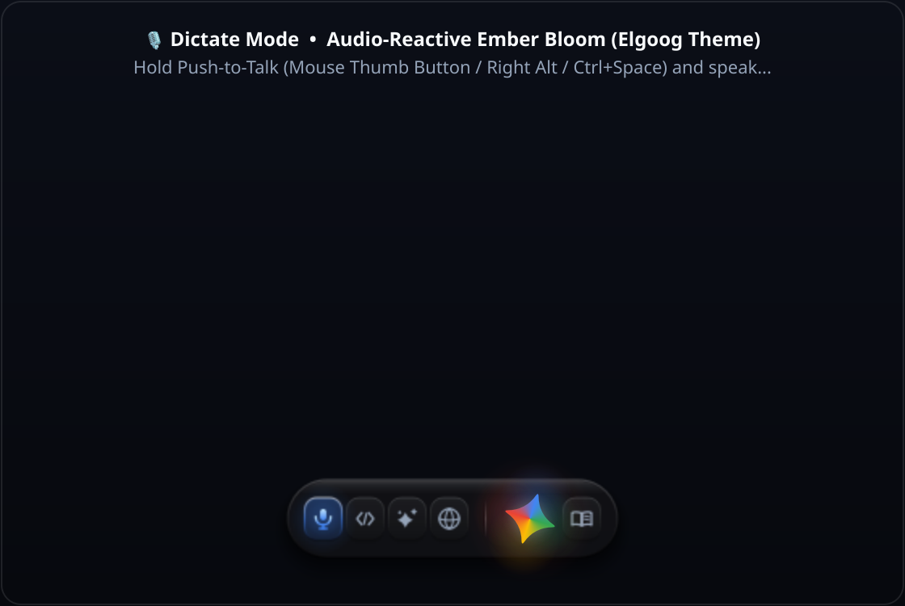
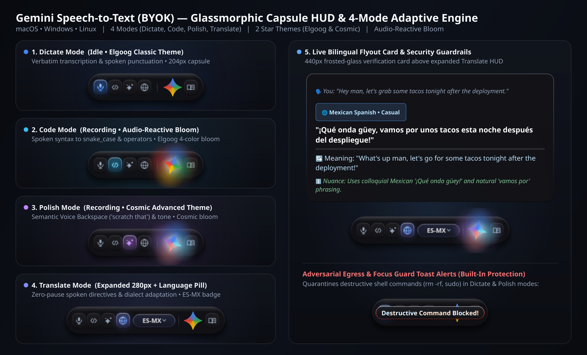

# Gemini Speech-to-Text (`gemini-s2t`)

> **Native 60fps Push-to-Talk AI Voice HUD & Inline Text Transformation Engine**  
> *Cross-Platform Desktop Client (Linux • macOS • Windows) Powered by Google Gemini Multimodal Audio (`gemini-3.5-flash`)*

  

  

---

## Overview

**Gemini Speech-to-Text (`gemini-s2t`)** is a lightweight, hardware-accelerated desktop voice HUD and inline text-transformation engine built in Python and PyQt6.

Hold down a global trigger (**Mouse Side Button** `Button 9` / `XButton2` or **Keyboard Hotkey**), speak naturally, and release—your speech is streamed directly to **Google Gemini (`gemini-2.5/3.5-flash`)** in a single multimodal audio pass and typed cleanly at your active cursor in milliseconds.

> [!IMPORTANT]
> **Repository Status — Showcase & Invite-Only Private Beta**  
> This public repository serves as the **engineering showcase, benchmark summary, and issue tracker** for `gemini-s2t`.  
> The full source repository is currently in **Invite-Only Private Beta**. To request access or inquire about the project, **[open a Beta Access Request Issue](../../issues/new?template=access_request.yml)**.

---

## Five Specialized Voice Modes + Inline Selection Editing

Click the mode pill on the HUD (or use the context menu) to cycle through **5 specialized processing modes**, each with its own color-graded 60fps shader palette:

| Mode | HUD Palette | What It Does |
| :--- | :--- | :--- |
| **Dictate** | **Google Blue** (`#4285F4`) | **Clean Verbatim Transcription** — Strips vocal fillers (*"um"*, *"uh"*) and false starts while keeping your exact wording, technical terms, and natural cadence intact. |
| **Polish** | **Warm Gold** (`#FBBC04`) | **Executive Rewrite & Tightening** — Transforms rambling spoken thoughts into crisp, publication-ready prose for emails, PR descriptions, Slack messages, and docs. |
| **Code** | **Neon Mint** (`#34A853`) | **Technical & Syntax-Aware Dictation** — Formats spoken identifiers (`snake_case`, `camelCase`, `PascalCase`), CLI flags, file paths, and code snippets accurately inside IDEs and terminals. |
| **Expand** | **Soft Violet** (`#A142F4`) | **Structured Elaboration** — Takes brief spoken bullet points or rough shorthand and expands them into well-structured paragraphs or specifications. |
| **Command** | **Coral Red** (`#EA4335`) | **Inline Cursor & Selection Transformation** — Highlight *any* text or code on screen, hold your trigger, and speak an instruction (e.g., *"make this more concise"*, *"translate to Spanish"*, *"convert this JSON to a TypeScript interface"*). Your highlighted selection is replaced in place. |

---

## Systems Engineering & Architecture Highlights

Rather than wrapping a headless browser or chaining separate speech-to-text and LLM pipelines, `gemini-s2t` was engineered from the ground up as a native desktop utility:

### 1. 60fps Custom `QPainter` Vector & Shader Pipeline (~40 MB RAM)
* **Zero Electron / WebView Overhead**: Rendered natively via a frameless, click-through translucent PyQt6 compositor surface (`WA_TranslucentBackground`), consuming **~40 MB of RAM** compared to `400–800 MB` for Electron-based voice wrappers.
* **Asymmetric Audio-Envelope Physics**: Real-time microphone RMS amplitude is processed through an asymmetric exponential moving average (fast attack, smooth exponential decay) that drives the 12-bar voice visualizer and multi-stop radial bloom at a locked 60fps.
* **Procedural Emblem & Spring Transitions**: All iconography, mode-pill typography, and state transitions (`Idle` → `Listening` → `Thinking` → `Success`) are mathematically rendered via procedural `QPainterPath` bezier geometry and spring-damped opacity curves—scaling cleanly across 1x, 2x Retina, and fractional-DPI displays.

### 2. Single-Pass Multimodal Audio Inference
* **No Cascaded ASR Bottleneck**: Traditional voice tools run a two-stage pipeline (`Audio → Whisper ASR → Text → LLM Rewrite`), compounding latency and losing vocal inflection or homophone context when the ASR guesses wrong.
* **Direct PCM-to-Gemini Streaming**: `gemini-s2t` captures 16 kHz mono PCM audio in memory and sends the audio buffer—paired with any highlighted screen selection and user dictionary terms—directly to `gemini-2.5-flash` in a **single multimodal inference pass**.
* **Sub-Second Turnaround**: Because Gemini hears the actual audio alongside your custom vocabulary and active mode, it resolves technical homophones, spoken punctuation, and self-corrections (*"meet at 3 PM—actually make that 4 PM"*) in one shot.

### 3. Cross-Platform OS Input & Non-Destructive Clipboard Hygiene
* **Unified Hardware Push-to-Talk**: Low-overhead global input hooks capture side mouse buttons (`Button 9` on Linux X11/Wayland, `XButton2` on macOS Quartz & Windows Win32) and configurable keyboard hotkeys (`F9`) without blocking normal cursor movement.
* **State-Preserving Cursor Injection**: Before injecting dictated or transformed text into the focused window, the engine snapshots the user's existing clipboard, performs atomic paste injection (with terminal-aware keystroke routing for emulators like GNOME Terminal, Kitty, Alacritty, iTerm2, and Windows Terminal), and restores the original clipboard state afterward.
* **Zero Audio Disk Persistence**: Microphone buffers live strictly in volatile RAM for the duration of the API request and are immediately garbage-collected—never written to disk.

### 4. One-Prompt Agentic Onboarding for Google Antigravity 2.0
* **Self-Configuring Cross-Platform Installer**: Includes a dedicated `.agents` onboarding skill engineered for **Google Antigravity 2.0**.
* **Prompt-to-Desktop-App in 60 Seconds**: When an invited user opens the repository in Antigravity 2.0 and pastes a single onboarding prompt, the agent autonomously detects the host OS (Linux, macOS, or Windows), configures the virtual environment and audio dependencies, validates the user's BYOK Gemini API key or Vertex AI ADC credentials, runs the 155-test verification suite, and installs a native standalone desktop app (`~/Applications/Gemini Speech-to-Text.app` on macOS, `~/.local/share/applications/*.desktop` on Linux, or windowless `pythonw.exe` Start Menu & Startup shortcuts on Windows).

---

## Real-World Production Telemetry & Unit Economics (BYOK)

Commercial AI dictation subscriptions typically charge **`$10.00 – $15.00 / month`** (`$120–$180/year`). Because `gemini-s2t` uses a **Bring Your Own Key (BYOK)** architecture directly against Google's `gemini-2.5-flash` pricing, actual API costs are fractions of a cent.

Below is empirical production telemetry recorded across **3,529 real-world dictations** over 29 days of daily software engineering and writing use:

| Metric | Recorded Production Value |
| :--- | :--- |
| **Total Dictations Analyzed** | `3,529` sessions |
| **Average Dictation Duration** | `15.74 seconds` (~35–45 words spoken) |
| **Mode Distribution** | `70.0%` Polish • `21.7%` Dictate • `8.3%` Command / Expand / Code |
| **Average Cost per Dictation** | **`$0.000461`** (~`1/20th` of one cent) |
| **Dictations per `$1.00` of API Spend** | **`~2,169 dictations`** (~9.5 hours of continuous speech) |
| **Cumulative 29-Day API Spend (Heavy Daily Use)** | **`$1.63 total`** (vs. `$12–$15/mo` SaaS subscription) |

---

## Built-In Cost & Usage Telemetry Dialog

Users can right-click the HUD at any time and open **Usage & Cost Stats** to inspect their local SQLite/JSON session ledger, broken down by time window (**Session**, **Today**, **7 Days**, **30 Days**, **All Time**), token counts, audio duration, and exact USD cost:

* **Custom Dictionary Dialog**: Add domain-specific jargon, product names, internal acronyms, or uncommon proper nouns directly from the HUD right-click menu.
* **Live Microphone & Trigger Switcher**: Hot-swap audio input devices or toggle between Mouse Side Button (`Button 9` / `XButton2`) and Keyboard (`F9`) without restarting the app.

---

## Requesting Access / Contact

The full source repository (`gemini-s2t-byok`)—including the cross-platform desktop app installer and the one-prompt Google Antigravity 2.0 setup skill—is currently shared via **private repository invitation**.

* **Request Beta Access**: [**Open an Access Request Issue →**](../../issues/new?template=access_request.yml)
* **Bug Reports & Feature Feedback (Invited Testers)**: [**Open a Feedback Issue →**](../../issues/new?template=feedback_or_bug.yml)

---

## Disclaimer & Attribution

* **Independent Project**: `gemini-s2t` is an independent software engineering project built using the official Google GenAI SDK (`google-genai`) and the Google Gemini API. It is **not** affiliated with, endorsed by, or sponsored by Google LLC.
* **Trademarks**: "Google" and "Gemini" are trademarks of Google LLC.
* **License**: Copyright © 2026 [PNWcoastie](https://github.com/PNWcoastie). All rights reserved.
